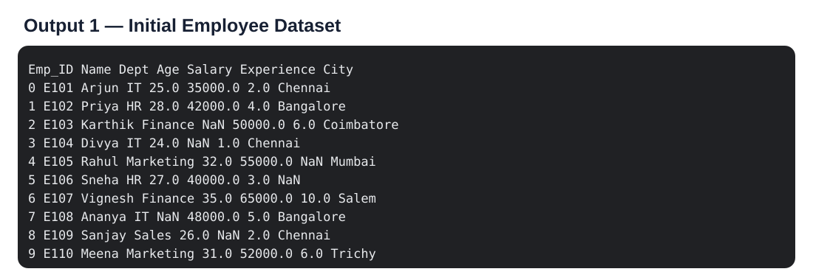
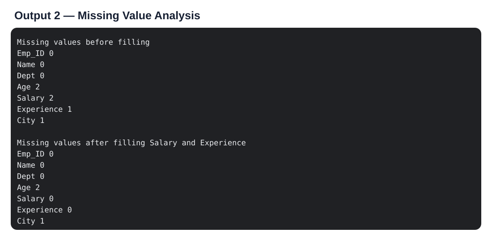
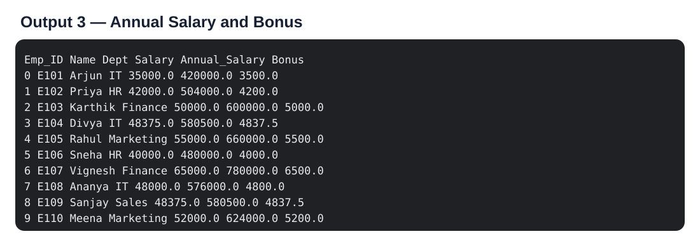
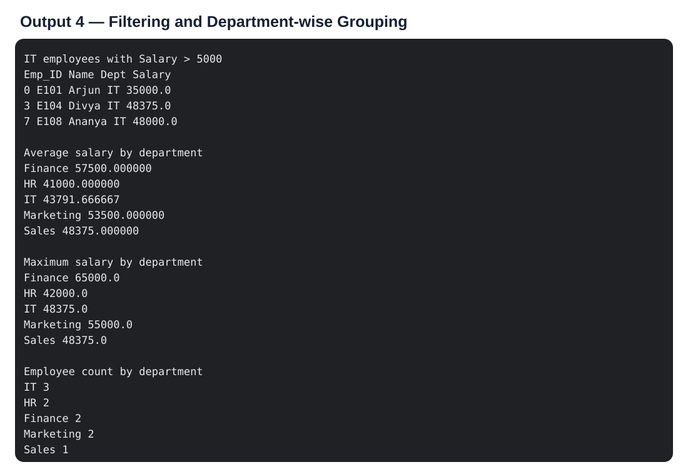
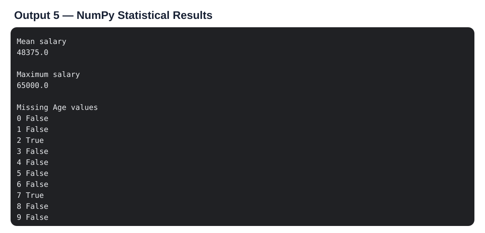
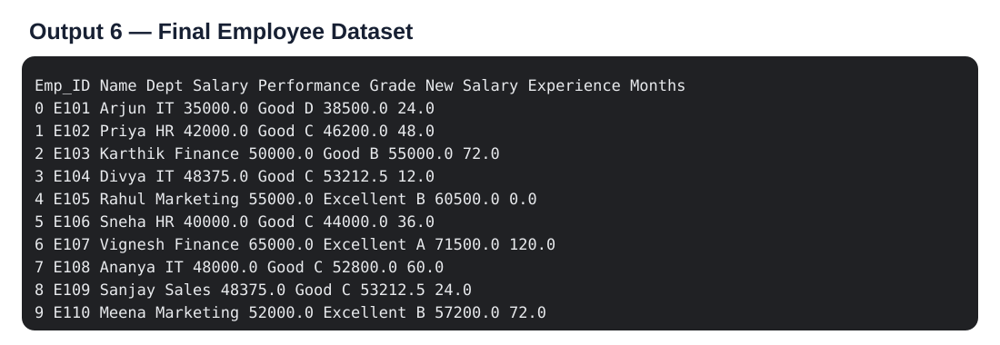

# Exno: 1
## Employee Data Analysis using Pandas and NumPy

### AIM
To create an employee dataset and perform data selection, missing-value handling, filtering, grouping, and numerical calculations using Pandas and NumPy.

### Explanation
Pandas is a Python library used to work with structured data in rows and columns. A DataFrame stores tabular data and supports selecting rows and columns, checking missing values, replacing missing values, filtering records, and grouping data.

NumPy provides numerical functions such as mean, maximum, conditional selection, rounding, and multiplication. In this experiment, an employee dataset containing employee ID, name, department, age, salary, experience, and city is created and analysed.

### Algorithm
STEP 1: Import the Pandas and NumPy libraries.

STEP 2: Create an employee dataset using a Python dictionary and convert it into a Pandas DataFrame.

STEP 3: Select columns, rows, and individual values using column indexing, `loc`, and `iloc`.

STEP 4: Identify missing values using `isnull()`, `isnull().sum()`, and `isnull().any()`.

STEP 5: Fill missing salary values with the column mean and missing experience values with zero.

STEP 6: Rename a column for display and create annual salary and bonus columns.

STEP 7: Filter employee records and group the data by department to calculate average salary, maximum salary, and employee counts.

STEP 8: Use NumPy functions to check missing age values and calculate salary statistics.

STEP 9: Create performance labels, salary grades, revised salary, and experience in months.

STEP 10: Display the final employee DataFrame.

---

# Coding

## 1. Import libraries and create the employee dataset

```python
import pandas as pd
import numpy as np

emp = {
    "Emp_ID": ["E101", "E102", "E103", "E104", "E105",
               "E106", "E107", "E108", "E109", "E110"],
    "Name": ["Arjun", "Priya", "Karthik", "Divya", "Rahul",
             "Sneha", "Vignesh", "Ananya", "Sanjay", "Meena"],
    "Dept": ["IT", "HR", "Finance", "IT", "Marketing",
             "HR", "Finance", "IT", "Sales", "Marketing"],
    "Age": [25, 28, np.nan, 24, 32, 27, 35, np.nan, 26, 31],
    "Salary": [35000, 42000, 50000, np.nan, 55000,
               40000, 65000, 48000, np.nan, 52000],
    "Experience": [2, 4, 6, 1, np.nan, 3, 10, 5, 2, 6],
    "City": ["Chennai", "Bangalore", "Coimbatore", "Chennai",
             "Mumbai", np.nan, "Salem", "Bangalore", "Chennai", "Trichy"]
}

df = pd.DataFrame(emp)
print(df)
```

## 2. Select rows and columns

```python
# Select a single column
df["Salary"]

# Select multiple columns
df[["Name", "Salary", "Age"]]

# Select rows using loc and iloc
df.loc[2:]
df.iloc[2:]

# Select individual values and a row
df.iloc[2, 4]
df.iloc[2]
df.iloc[3, 2]
df.loc[3:1]
```

## 3. Check and handle missing values

```python
# Identify missing values
df.isnull()
df.isnull().sum()
df.isnull().any()

# Fill missing Salary with its mean
df["Salary"].fillna(df["Salary"].mean(), inplace=True)

# Fill missing Experience with zero
df["Experience"].fillna(0, inplace=True)

df
df.isnull().sum()
```

## 4. Rename a column and calculate salary values

```python
# Display a renamed view of the Salary column
df.rename(columns={"Salary": "Monthly_Salary"})

# Calculate annual salary and 10% bonus
df["Annual_Salary"] = df["Salary"] * 12
df["Bonus"] = df["Salary"] * 0.10

df
```

## 5. Filter and group employee records

```python
# Filter employees by salary
df[df["Salary"] > 5000]

# Filter IT department employees
df[(df["Salary"] > 5000) & (df["Dept"] == "IT")]

# Department-wise average salary
df.groupby("Dept")["Salary"].mean()

# Find unique departments
df["Dept"].unique()

# Department-wise maximum salary and employee count
df.groupby("Dept")["Salary"].max()
df["Dept"].value_counts()
```

## 6. Perform NumPy operations and create derived columns

```python
# Check missing Age values
np.isnan(df["Age"])

# Calculate mean and maximum salary
np.mean(df["Salary"])
np.nanmax(df["Salary"])

# Calculate bonus and performance
df["Bonus"] = np.round(df["Salary"] * 0.10, 3)
df["Performance"] = np.where(
    df["Salary"] > 50000, "Excellent", "Good"
)

# Assign grades based on salary
df["Grade"] = np.select(
    [
        df["Salary"] >= 60000,
        df["Salary"] >= 50000,
        df["Salary"] >= 40000
    ],
    ["A", "B", "C"],
    default="D"
)

# Calculate revised salary and experience in months
df["New Salary"] = np.multiply(df["Salary"], 1.10)
df["Experience Months"] = np.multiply(df["Experience"], 12)

df
```

---

# Output

## 1. Initial Employee Dataset



## 2. Missing Value Analysis



## 3. Annual Salary and Bonus Calculation



## 4. Filtering and Department-wise Grouping



## 5. NumPy Statistical Operations



## 6. Final Employee Dataset



---

# Result
Thus, the employee dataset was created and analysed using Pandas and NumPy. The experiment demonstrated row and column selection, missing-value identification and handling, filtering, department-wise grouping, statistical operations, and the creation of calculated columns such as annual salary, bonus, performance, grade, revised salary, and experience in months.

---

**Note:** The output images are prepared from the saved outputs in the supplied Colab notebook. The code above follows the operations in that notebook.